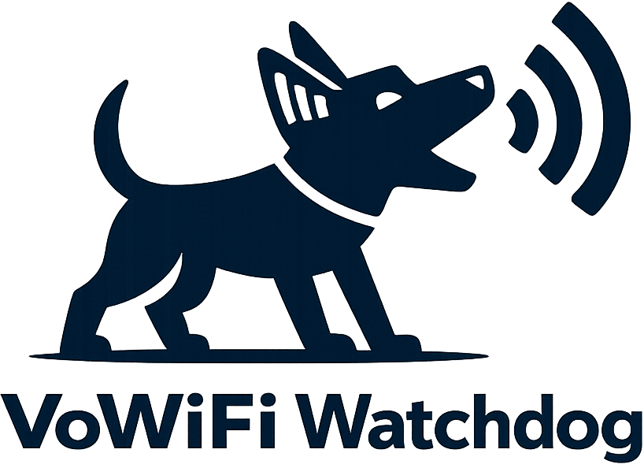
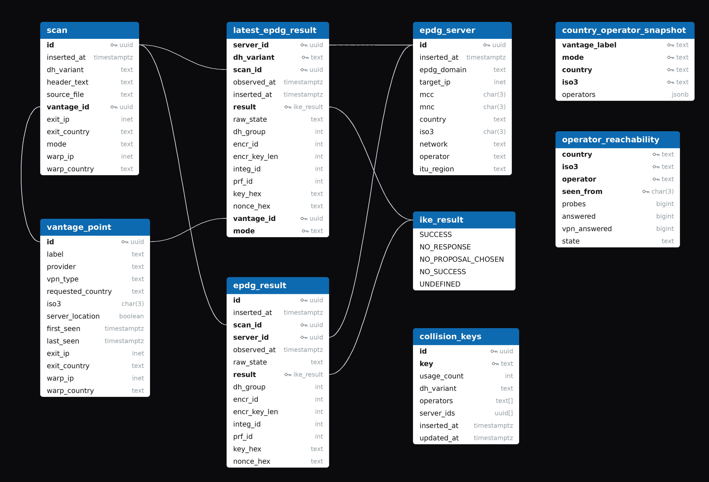

<h1 align="center">
  <picture>
    <source media="(prefers-color-scheme: dark)" srcset="apps/frontend/static/data/vowifi_watchdog_logo_light.png">
    
  </picture>
</h1>

<p align="center">
  Keeping an eye on how mobile operators around the world secure Wi-Fi calling.
  <br>
  <a href="https://vowifi.mobileatlas.eu"><b>Website</b></a> ·
  <a href="https://publications.sba-research.org/publications/CR_Diffie_Hellman_Picture_Show_Key_Exchange_S_Gabriel%20Gegenhuber.pdf"><b>Paper</b></a>
</p>

For Wi-Fi calling, your phone sets up an IPsec tunnel to your operator's ePDG with an IKEv2 handshake, and your calls run through that tunnel. How well it protects them depends a lot on the Diffie-Hellman group the phone and the ePDG agree on, but as a subscriber you have no easy way to find out what your operator accepts.

VoWiFi Watchdog tries to change that. This repository contains everything behind it: a pipeline that finds ePDGs all over the world, keeps testing their IKEv2 handshakes and publishes the results on the website and as an open dataset.

The project builds on the paper [Diffie-Hellman Picture Show: Key Exchange Stories from Commercial VoWiFi Deployments](https://publications.sba-research.org/publications/CR_Diffie_Hellman_Picture_Show_Key_Exchange_S_Gabriel%20Gegenhuber.pdf) (USENIX Security '24).

## What's on the website

- **Map**: which Diffie-Hellman groups the operators in each country support, measured from the scanning host or through VPNs in other countries. A geoblocking view shows which countries each operator's ePDGs answer.
- **Data table**: the latest results or the full history, with filters for country, operator, DH group and more.
- **Key collisions**: IKE keys that show up on more than one server.
- **DH group history**: how an operator's DH group support has changed over time.
- **Fingerprinting**: ePDGs grouped by how they answer the handshake tests, which hints at operators sharing the same ePDG software or setup. This page is a static snapshot made with `tools/fingerprint/`.
- **Downloads**: the whole dataset as CSV files or as an SQL dump.

## How it works

At the heart of it is the scanner (`apps/core/scanner/main.py`), which runs through the same cycle every 8 hours:

1. **Discovery**: it builds a candidate ePDG domain for every MCC/MNC pair (`epdg.epc.mnc<MNC>.mcc<MCC>.pub.3gppnetwork.org`) and keeps the ones that resolve, using zdns.
2. **Enrichment**: each ePDG gets a country, operator and network, based on MCC/MNC data from mcc-mnc.com and Wikipedia.
3. **Scanning**: every ePDG gets 16 IKEv2 handshake tests. 14 of them check support for one Diffie-Hellman group each (from 768-bit MODP up to X25519), and the other two check how it handles downgrades.
4. **Storage**: the results go into Postgres. Then everything built from them is refreshed: the map data, the key collisions and the downloadable dataset.

Meanwhile, the vantage orchestrator runs the same tests through VPN tunnels in other countries. More on that in [Scanning from other countries](#scanning-from-other-countries).

## Getting started

All you need is Docker with the Compose plugin. Copy the example config, fill in the required values (see [Configuration](#configuration)) and start the stack:

```bash
cp .env.secrets.example .env.secrets
docker compose build
docker compose up -d
```

Make sure to run `docker compose` from the repository root. The orchestrator starts its own containers through the Docker socket, and it uses `${PWD}` to tell the Docker daemon where the project lives on the host.

On the first start, Postgres sets up the database schema by itself. Everything the stack collects ends up in `./epdg-container/`. Once it's running, you'll find the website at http://127.0.0.1:8081 and adminer at http://127.0.0.1:8080.

### What's running

| Service | What it does | Port |
|---|---|---|
| `epdg-scanner` | discovery and the 8-hour scan cycle | |
| `vantage-orchestrator` | scans through VPN tunnels in other countries | |
| `warp-hop` | the Cloudflare WARP tunnel. Compose only builds the image, and the orchestrator starts it when needed | |
| `postgres` | the database | |
| `api-backend` | the FastAPI backend | `127.0.0.1:8000` |
| `frontend` | the website, static files served by nginx | `127.0.0.1:8081` |
| `adminer` | a web UI for the database | `127.0.0.1:8080` |
| `key-collision-zulip-bot` | posts IKE key collisions to Zulip | |

### Configuration

Settings go into `.env.secrets`, and the example file comes with comments to help you fill it in. You'll need at least:

- the Postgres connection: `POSTGRES_HOST`, `POSTGRES_PORT`, `POSTGRES_USER`, `POSTGRES_PASSWORD`, `POSTGRES_DB`
- `DATABASE_URL` for the API, or `DATABASE_URL_FILE` pointing to a secret file
- `MCC_MNC_API_TOKEN`, because mcc-mnc.com no longer allows anonymous access. Without it, the scan cycle fails.

Everything else is optional:

- **API**: `API_KEY` (or `API_KEY_FILE`), `ENABLE_DOCS`, `DEFAULT_LIMIT`, `MAX_LIMIT`, `ENABLE_RATE_LIMIT`, `RATE_LIMIT_REQUESTS_PER_MINUTE`, `RATE_LIMIT_TIMEOUT_SECONDS`
- **Logging**: `LOG_LEVEL`
- **Zulip bot**: `ZULIP_SERVER_URL`, `ZULIP_BOT_EMAIL`, `ZULIP_BOT_API_KEY`. Without them the bot simply exits.
- **VPN vantage points**: see [Setting up vantage points](#setting-up-vantage-points). Set `VANTAGE_ENABLED=false` to scan only from the host.

The API's name, version, worker count and database pool (`APP_NAME`, `UVICORN_WORKERS`, `DB_POOL_SIZE` and so on) are set in `compose.yaml` itself.

> [!NOTE]
> The website sends the same `API_KEY` to the API. It's hardcoded in `map.js`, `table.js`, `collisions.js`, `history.js` and `takeout.js` under `apps/frontend/static/js/`, so if you change the key, change it there too.

## Scanning from other countries

Some ePDGs only answer clients from certain places. One that happily completes a handshake with a client in Austria might ignore the exact same handshake from Brazil. To catch that, the `vantage-orchestrator` repeats the scans through [gluetun](https://github.com/qdm12/gluetun) VPN tunnels in other countries. Each VPN location is called a *vantage point*. The idea and much of the setup come from [scanywhere](https://github.com/sbaresearch/scanywhere).

### Scan modes

Every vantage point is scanned in three different ways. The host has a fourth mode of its own:

| Mode | Targets | Route | Test cases |
|---|---|---|---|
| `local` | the shared target list | straight from the host | all 16 |
| `full` | found by zdns inside the tunnel | VPN exit | all 16 |
| `full_warp` | everything in `epdg_server` | VPN exit, then Cloudflare WARP | all 16 |
| `dh2048_warp` | everything in `epdg_server` | VPN exit, then Cloudflare WARP | `SUPPORT_DH_2048MODP` only |

`local` is simply the host's regular 8-hour cycle. The three VPN modes run around the clock, independently of each other. A `full` scan takes about 13 hours per vantage point, a `dh2048_warp` sweep only about 35 minutes.

Why WARP? Blocking happens per IP address. Through WARP, the same VPN exit shows up as a Cloudflare address instead of a VPN one, so you can compare how an ePDG treats the two.

### How a vantage scan runs

For each vantage point, the orchestrator:

1. starts a gluetun container connected to one VPN provider and country.
2. for the WARP modes, starts a second gluetun container (`warp-hop`) that connects to Cloudflare through the first one. If that tunnel doesn't come up, it retries once on a different VPN server (see `WARP_HOP_ATTEMPTS`) and otherwise skips the run.
3. starts `epdg-scanner` with `SCANNER_ROLE=vantage_scan` inside the network namespace of the innermost tunnel.
4. ingests the results once the scan is done and removes the containers. The scanner can't reach Postgres from inside the tunnel, so the orchestrator takes care of that.

### Setting up vantage points

The VPN providers to use are listed in [`infrastructure/vantage_points.json`](infrastructure/vantage_points.json):

```json
[
  { "provider": "surfshark_open" },
  { "provider": "nord_open" },
  { "provider": "cyberghost_open" }
]
```

You can choose from `nord_open`, `nord_wg`, `mullvad_wg`, `surfshark_open`, `surfshark_wg`, `proton_open`, `pia_open`, `hma_open`, `cyberghost_open`, `ivpn_open` and `ivpn_wg` (`_open` is OpenVPN, `_wg` is WireGuard).

There's no country setting. Each round takes one country per provider from a shuffled list of everything that provider offers, so every country gets its turn once per pass. Each mode keeps its own rotation, and a restart reshuffles it. Vantage points are named `<service>-<country>`, for example `surfshark-japan`.

Credentials go into `.env.secrets` under the same variable names scanywhere uses. The [gluetun wiki](https://github.com/qdm12/gluetun-wiki/tree/main/setup/providers) explains where to get them for each provider. A provider is only used once all of its variables are set. To see which ones are ready:

```bash
docker compose run --rm vantage-orchestrator python3 -m vantage.providers
```

There are a few more settings. `LOCAL_VANTAGE_LABEL` and `LOCAL_VANTAGE_COUNTRY` name the host's own vantage point (`austria` by default). The per-mode `VANTAGE_*_TIMEOUT_SECONDS` limit how long a single scan may take, and `WARP_HOP_ATTEMPTS` sets how often the WARP tunnel is tried. If you just want to check that a tunnel works, set `TESTCASES_OVERRIDE=SUPPORT_DH_1024MODP` and each scan runs only that one test case.

The gluetun server lists aren't part of the repo. The orchestrator downloads any missing ones into `infrastructure/gluetun/servers/` when it starts, and skips providers it has no list for.

### Parallelism

A tunnel only starts when two limits allow it:

- **Per VPN service**: the subscription's device limit. That's NordVPN 6, CyberGhost 7, IVPN 7, ProtonVPN 10, Mullvad 5, HMA 5, and unlimited for Surfshark and PIA. All modes share this limit, and so do the `_open` and `_wg` variants of a service.
- **Per mode**: `VANTAGE_FULL_PARALLEL` (default 2), `VANTAGE_FULL_WARP_PARALLEL` (3) and `VANTAGE_DH2048_WARP_PARALLEL` (2). Modes never take each other's slots.

With the defaults, that's 7 tunnels almost all the time, each with two or three containers running tcpdump and IKEv2 scans. Check the host's load before you raise them.

### Monitoring

To follow what the orchestrator is doing:

```bash
docker compose logs -f vantage-orchestrator
```

Each log line starts with the vantage point's label. Every `VANTAGE_PROGRESS_SECONDS` (15 minutes by default), the orchestrator also prints a table of all running vantage points with their VPN exit, WARP IP and scan progress. If you see `exit country is X, expected Y`, the provider routed the tunnel through a different country than requested. The results are then stored under the country the tunnel actually exited from.

### Things to keep in mind

- Disk usage grows with every vantage point. Results and pcaps go to `epdg-container/data/results/vantage/<label>/`.
- Surfshark and NordVPN usually have no IPv6 over OpenVPN, so those vantage points only scan IPv4.
- DNS goes through gluetun's resolver over the tunnel, which uses a public resolver. The GeoDNS answers are what that resolver gets, which may differ from what a local ISP's resolver would get.

> [!CAUTION]
> Consumer VPN subscriptions are meant for light use. A full pass is about 500 domains times 16 test cases per vantage point, which can break a provider's terms or run into rate limits. Keep that in mind before adding more vantage points.

## Working with the data

There are three ways to get at the data: download the whole dataset from the website, query the API, or connect to Postgres directly (adminer works well for a quick look).

### Database

Postgres creates the schema from `db/migrations/` on its first start. The main tables are `epdg_server` (one row per ePDG), `scan` and `epdg_result` (every test run and its results), `latest_epdg_result` (the newest result per server, test case, vantage point and mode), `vantage_point` and `collision_keys`. The map reads from two materialized views, `country_operator_snapshot` and `operator_reachability`. [db/README.md](db/README.md) goes through all of them in more detail.



A few things that are easy to trip over:

- A vantage point gets a new `vantage_point` row whenever its exit IP changes, so filter scan history by `label`, not by `vantage_id`.
- `scan.exit_ip` is the VPN exit, or the host's own IP for `local` scans. `scan.warp_ip` is the Cloudflare WARP hop in front of it, and it's null for modes without one.
- Key collisions only count the host's own scans. GeoDNS hands out different IPs for the same ePDG in different countries, which would otherwise look like collisions.

> [!CAUTION]
> `db/migrations/999_drop_everything.sql` deletes all tables, functions and data. It never runs on its own.

### API

The website gets its data from a small FastAPI backend on `127.0.0.1:8000`. If `API_KEY` is set, requests to `/api/v1` need it in the `X-API-Key` header or as the `api_key` query parameter. With `ENABLE_DOCS=true` you also get interactive docs at `/docs`. All routes, parameters and filters are listed in [apps/api/README.md](apps/api/README.md).

## Project structure

```
apps/
  core/              scanner: discovery, enrichment, IKEv2 tests, ingest
  orchestrator/      VPN vantage points
  warp/              WARP hop image
  api/               FastAPI backend
  frontend/          website
  bot/               Zulip bot
db/                  migrations, schema diagram
infrastructure/      nginx, gluetun and vantage point config
tools/fingerprint/   offline IKEv2 fingerprinting (snapshot on the website)
```

The opt-in IKEv2 probes (outer/inner-tunnel crypto, certificate, identity) are documented in [`apps/core/scanner/ikev2/PROBES.md`](apps/core/scanner/ikev2/PROBES.md).

## Acknowledgements

This project was funded through the [NGI Mobifree Fund](https://nlnet.nl/mobifree/), a fund established by [NLnet](https://nlnet.nl) with financial support from the European Commission's [Next Generation Internet](https://ngi.eu) programme under the aegis of [DG Communications Networks, Content and Technology](https://commission.europa.eu/about-european-commission/departments-and-executive-agencies/communications-networks-content-and-technology_en). The [NGI Mobifree](https://mobifree.eu) R&D programme is part of [Horizon Europe](https://ec.europa.eu/programmes/horizoneurope/) research and innovation programme under grant agreement No. [101135795](https://cordis.europa.eu/project/id/101135795).

It also builds on these tools and data sources:

- [scanywhere](https://github.com/sbaresearch/scanywhere) for the VPN vantage point setup
- [gluetun](https://github.com/qdm12/gluetun) for the VPN and WARP tunnels
- [zdns](https://github.com/zmap/zdns) for DNS resolution
- MCC/MNC data from [mcc-mnc.com](https://mcc-mnc.com/) and [Wikipedia](https://en.wikipedia.org/wiki/Mobile_network_codes)
- [Natural Earth](https://www.naturalearthdata.com/) country boundaries, via [natural-earth-geojson](https://github.com/martynafford/natural-earth-geojson)
- MapLibre GL, AG Grid, ECharts and D3 on the website (see [apps/frontend/static/vendor/](apps/frontend/static/vendor/))

Please respect their licenses and terms when you use or redistribute this project.
